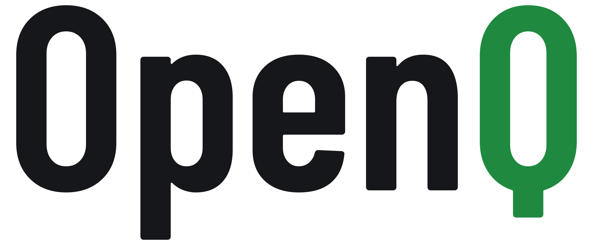
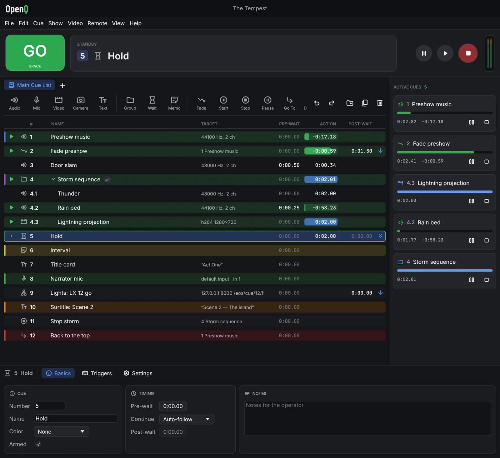

<p align="center">
  <picture>
    <source media="(prefers-color-scheme: dark)" srcset="docs/img/logo-dark.svg">
    
  </picture>
</p>

<h3 align="center">Live show control for sound, video and the stage</h3>

<p align="center">
  <b>English</b> · <a href="README.es.md">Español</a> · <a href="README.gl.md">Galego</a>
  &nbsp;|&nbsp; 🌐 <a href="https://iagonunez.github.io/OpenQ/">Website</a>
  &nbsp;|&nbsp; 📖 <a href="https://iagonunez.github.io/OpenQ/manual/">User manual</a>
</p>

---

## 🎭 About

OpenQ runs a theatre, concert or event from a list of cues: every press of **GO** fires the next
one, whether it's music, a sound effect, a movie on a projector, a title on a screen, a fade, or a
message to the lighting desk. It is an open-source application written in Rust with
[egui](https://github.com/emilk/egui), and it's free to use, including for commercial productions.

NOTE: Seeing the hype around REA and cloned apps, I have to say here that this is a project started from scratch, not a clone of QLab. I have my own ideas and roadmap for it, so there are things that are similar and things that will be very different.

### 📖 The story behind OpenQ
I first started working on live shows as a teenager and always admired the work of the people at Figure 53 with QLab as the industry standard for any live production. Later I studied Electrical Engineering and began working as a Software Engineer. I have always had this project on the back of my mind as the perfect hobby project, so I finally decided to start working on it.

My goal is to democratize live production control software, so people can afford it without having to buy expensive Apple hardware or a costly license if they don't have the means.

This is currently an alpha version of what I hope can be a very reliable piece of software, but as it's just a hobby project, using it comes with its own risks since it isn't battle-tested in live scenarios like QLab is. For that reason, I would recommend any professional who can afford it and wants proper customer service and support to use QLab.

That said, I welcome any advice on missing features and bug reports. The software automatically generates a log file when it fails, which is really useful if you want to report a bug.

For now, I'm keeping contributions closed since I don't have the time to review and manage pull requests, but you're more than welcome to fork the repo and build your own features on top of it if you'd like.

<p align="center">
  
</p>

<p align="center">
  <a href="LICENSE.md"></a>
</p>

## 📦 Install

OpenQ is installed by **[OQup](https://github.com/iagonunez/OQup)**, an installer in the style of
rustup. It downloads the newest OpenQ release for your system with the LGPL-only FFmpeg libraries it
uses (on Linux it also installs missing sound and device libraries from your distribution's
packages, asking first), adds the OQVis 3D visualiser for the lighting workspace and installs the
app with a menu entry. `oqup update` installs a new version when one is released, `oqup versions`
lists them and `oqup uninstall` removes it. `oqup install --build-source` compiles OpenQ on your
computer instead (installing Rust and the build dependencies if they're missing).
`oqup install --no-lighting` installs the cues only, without the lighting workspace or OQVis
(`--lighting` adds it back).

### 🐧 Linux and 🍎 macOS

```sh
curl --proto '=https' --tlsv1.2 -fsSL https://github.com/iagonunez/OQup/releases/latest/download/install.sh | sh
```

The Linux binaries need Debian 12, Ubuntu 23.04, Fedora 37 or newer (glibc 2.36). On older systems use
`oqup install --build-source --no-default-features --features video,lighting` (sound through ALSA: their
PipeWire is too old for OpenQ's PipeWire support).

### 🪟 Windows 10/11 (64-bit), in PowerShell

```powershell
powershell -ExecutionPolicy Bypass -c "irm https://github.com/iagonunez/OQup/releases/latest/download/install.ps1 | iex"
```

The app is installed to `~/Applications/OpenQ.app` (macOS, code-signed ad hoc or with your
Developer ID: `--sign`), `%LOCALAPPDATA%\Programs\OpenQ` (Windows) or `~/.local/share/oqup/app`
with a link in `~/.local/bin/openq` (Linux). OQup's README lists every download, its source and its
license.

### 🛠️ From source by hand (Linux; what `oqup install --build-source` does there)

```sh
# Debian/Ubuntu
sudo apt install build-essential clang pkg-config libasound2-dev libpipewire-0.3-dev libudev-dev \
  libavcodec-dev libavformat-dev libavutil-dev libavdevice-dev libavfilter-dev \
  libswscale-dev libswresample-dev
# Fedora:  sudo dnf install clang pkgconf alsa-lib-devel pipewire-devel systemd-devel ffmpeg-free-devel
# Arch:    sudo pacman -S --needed base-devel clang pkgconf alsa-lib libpipewire ffmpeg
curl https://sh.rustup.rs -sSf | sh          # Rust, if you don't have it
git clone https://github.com/iagonunez/OpenQ && cd OpenQ
cargo build --release && ./target/release/openq
```

> [!NOTE]
> Audio goes through PipeWire when it is running (each sink and source is listed by name), and
> through ALSA otherwise. Without the PipeWire headers, build with
> `--no-default-features --features video` (ALSA only).

## ✨ Features

| | Feature | What it does |
|---|---|---|
| 🎬 | **15 cue types** | Audio, Video, Text, Camera, Mic, Group, Wait, Memo, Fade, Start, Stop, Pause, Go To, Devamp and Network (OSC). |
| 🗂️ | **Cue lists** | Several lists per show in tabs (the main sequence, a list of effects to fire by hand…); cues keep playing when you switch. |
| ⏱️ | **Timing** | Pre-wait, post-wait, auto-continue and auto-follow. Chained cues start on the exact sample, however long the chain. |
| 📁 | **Groups** | Enter the group, playlist, start everything at once, or a random child. |
| 🔒 | **Edit and show mode** | Build the show in edit mode; show mode locks the list and gives you big, readable rows for the booth. |
| 🔊 | **Audio playback** | Trims, loops, fade in/out, varispeed and slices that vamp until a Devamp cue releases them. |
| 🎚️ | **Mixer and routing** | Level, pan, output faders and a crosspoint matrix per cue, with dB on every crosspoint. |
| 📈 | **EQ** | Up to 8 bands per cue (pass filters, shelves, peaks), with a draggable response curve. |
| 🎛️ | **Audio effects** | Delay, reverb, compressor, limiter, gate, distortion, chorus and bitcrusher chains that can be edited live. |
| 🔈 | **Object audio** | Place each channel in a room of speakers (stereo to 7.1 or your own layout); Fade cues fly sounds around. |
| 🎤 | **Live inputs** | Mic cues play a microphone or line input through the same mixer, EQ and effects. |
| 🎞️ | **Video and stills** | Anything FFmpeg can play, plus PNG, JPEG, WebP, GIF and sharp SVG, with trims, loops and soundtrack routing. |
| 🔤 | **Text cues** | Titles and surtitles in any installed font, with outline, shadow and a background box; every language and emoji. |
| 📐 | **Geometry and animation** | Position, scale, rotation, crop and opacity, plus keyframe animation with easing curves, evaluated live on the GPU. |
| 🌈 | **Video effects** | Colour controls, hue, colourise, blur, pixellate, vignette, chroma key and more, drawn live by the graphics card. |
| 🧩 | **Blend modes** | Add, Screen, Multiply, Lighten, Darken and Subtract per layer. |
| 📽️ | **Stages and projection mapping** | Any number of outputs, fullscreen on any display, with corner-pin keystone and a mapping test pattern. |
| 🌅 | **Edge blending** | Split one picture across several projectors with soft, gamma-corrected overlaps. |
| 📷 | **Camera cues** | Show a live camera or capture card as a layer on stage. |
| 🌗 | **Fades** | Fade level, opacity, geometry, video effects and object positions, with preset or custom curves. |
| 🕰️ | **Timecode** | Each cue list can follow LTC or MTC and fire cues at their timecode trigger. |
| ⌨️ | **Hotkeys** | Fire any cue straight from its own key. |
| 📡 | **OSC** | Control OpenQ from other gear over OSC, and send OSC to lighting desks with Network cues. |
| 📱 | **Remote devices** | Pair a laptop or a tablet to follow the show, run it or edit it, over an encrypted link. |
| 🛟 | **Crash safety** | Autosave and recovery, atomic saves, audio devices that reconnect by themselves, and an error log. |
| ↩️ | **Undo and redo** | Up to 200 steps. |
| 💻 | **Cross-platform** | Linux, macOS and Windows. |

## 📖 User manual

Everything above is explained step by step, with pictures, in the **user manual**, which comes with
the app: choose **Help → User manual** or press **F1** and it opens in your web browser. It works
offline and always matches your version of OpenQ. Like the app itself (pick the language on the first run or in
**Settings → General**), it is available in English, Spanish and Galician, and you can also read it [online](https://iagonunez.github.io/OpenQ/manual/).

## 🎨 Look and credits

The UI uses a dark theme (`src/ui/theme.rs`) with bundled fonts in `assets/fonts`:

- [Material Symbols Rounded](https://fonts.google.com/icons) icons (Apache-2.0)
- [Inter](https://fonts.google.com/specimen/Inter) for text and
  [JetBrains Mono](https://fonts.google.com/specimen/JetBrains+Mono) for times, and
  [Barlow Condensed](https://fonts.google.com/specimen/Barlow+Condensed) for the OpenQ title
  (SIL OFL 1.1)

They are subset to the glyphs in use. To add an icon, put its name in `tools/icons.txt` and
rebuild with `python3 -I tools/build_fonts.py <dir with the upstream font files>`, which also
regenerates `src/ui/icons.rs`.

## ⚖️ License

Copyright 2026 Iago Núñez. OpenQ is licensed under the **Apache License 2.0** ([LICENSE.md](LICENSE.md)):

- ✅ **Allowed:** any use, including commercial productions. You may run paid shows, concerts,
  events and installations, and be paid to program or operate them. You may copy, change and share
  OpenQ, keeping the copyright notice, `LICENSE.md` and `NOTICE.md` with every copy.
- ✅ **Also allowed:** selling copies or changed versions of OpenQ, and hosting, support or
  consulting services built on it. Changed files must say that they were changed.

Third-party fonts, crates and system libraries keep their own licenses. They are listed in
[NOTICE.md](NOTICE.md) and [THIRD_PARTY_LICENSES.md](THIRD_PARTY_LICENSES.md), and are also shown
in the app under **Help → About OpenQ and licenses**. Two points to note when distributing binaries:

- Ship `LICENSE.md`, `NOTICE.md`, `THIRD_PARTY_LICENSES.md` and `assets/fonts/*.txt` with them.
  The app also contains these texts.
- Build against an **LGPL-only FFmpeg**, or use `--no-default-features`. A GPL build of FFmpeg
  (`--enable-gpl`, as many Linux distributions ship it) puts a distributed binary as a whole
  under GPL 3, with its complete source.

After changing dependencies, run `python3 -I tools/third_party_licenses.py`.

OpenQ is open source: the Apache License 2.0 is approved by the Open Source Initiative.
